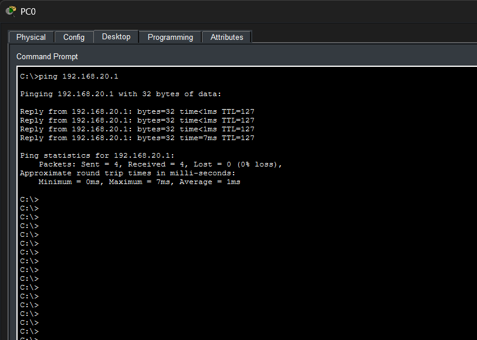
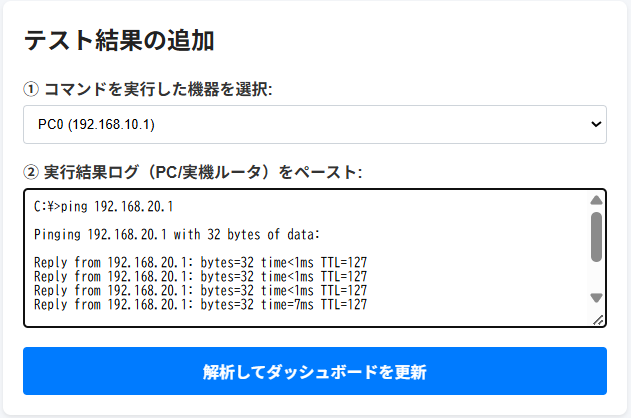
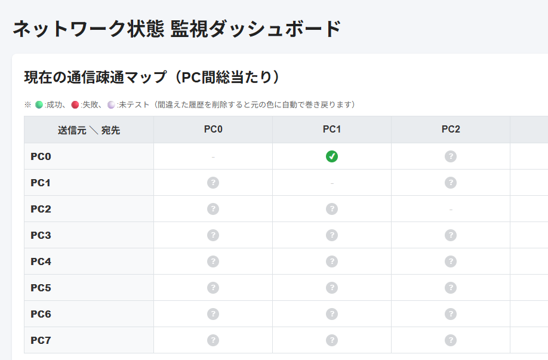
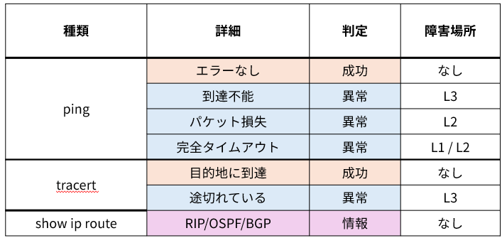

# network-dashboard

## 1. 概要
ネットワークのトラブルシューティングを支援するダッシュボードアプリである。

ネットワーク技術の学習にあたり、実機を用いて以下のようなネットワークトポロジーを構築し、各種設定や通信の検証を行った。

しかし、実際にネットワークを構築する過程では、通信障害の原因特定や経路の確認など、トラブルシューティングに多くの手間がかかった。

そこで、これらの作業を効率化し、ネットワークの状態や通信経路を視覚的に把握できるようにすることを目的として、本アプリを開発した。

**対応するネットワークトポロジー**


## 2. 環境構築手順（Windows | PowerShell）
1. 適当なディレクトリで以下のコマンドを実行する。
```bash
git clone https://github.com/sus-2026sys2b-d4/network-dashboard
cd ./network-dashboard
```

2. 以下のコマンドで仮想環境を作成する
```bash
py -3.12 -m venv .venv
Set-ExecutionPolicy -ExecutionPolicy RemoteSigned -Scope CurrentUser
.\.venv\Scripts\activate.ps1
```
3. 以下のコマンドを実行し、必要なライブラリをインストールする
```bash
python -m pip install --upgrade pip
pip install -r requirements.txt
```
4. hello.pyを実行して動作確認する


## 3. 実行手順
1. 以下のコマンドを実行し、app.pyでWebサーバーを起動する。
```bash
python src/app.py
```
2. コマンドラインに表示されたURLにアクセスする。

3. 左下の「テスト結果を追加」というフォームにコマンドを実行した機器とその出力結果を記述する。その後、「解析してダッシュボードを更新」というボタンを押す。

**PCでの`ping`コマンドと、ダッシュボードでの入力**




4. 結果が図で表示される。これにより、「通信ができているか」、
「どこで問題が発生しているか」、がひと目で可視化できる。

**ダッシュボードでの出力結果**



## 4. 設定内容
このダッシュボードでは、`ping`, `tracert`, `show ip route`などのコマンドに対応し、その情報によって下図のような情報を確認できる。


**結果の設定内容**
